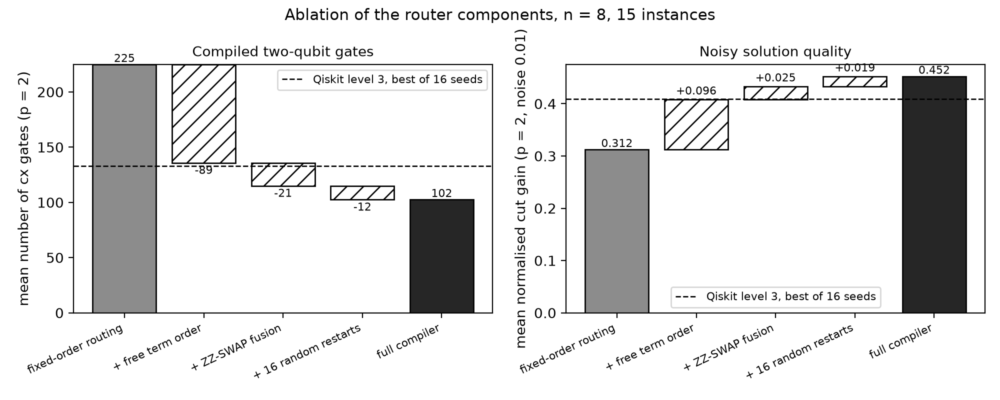
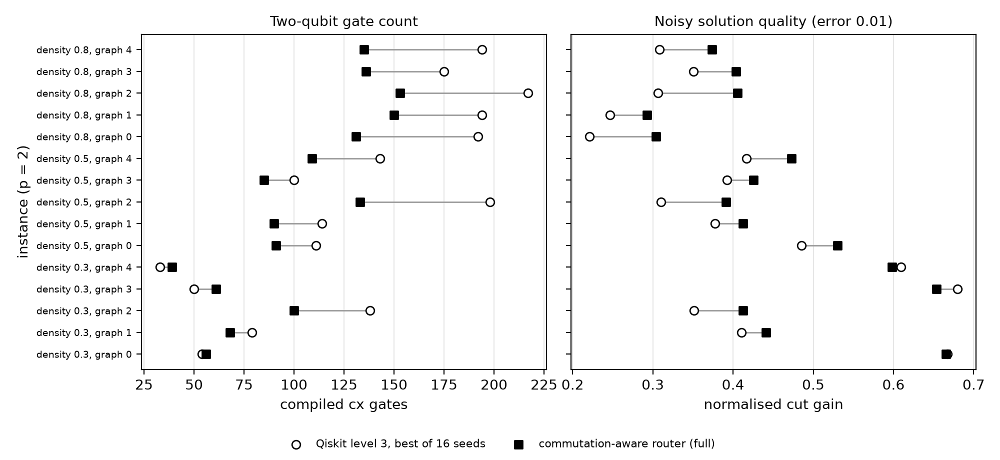
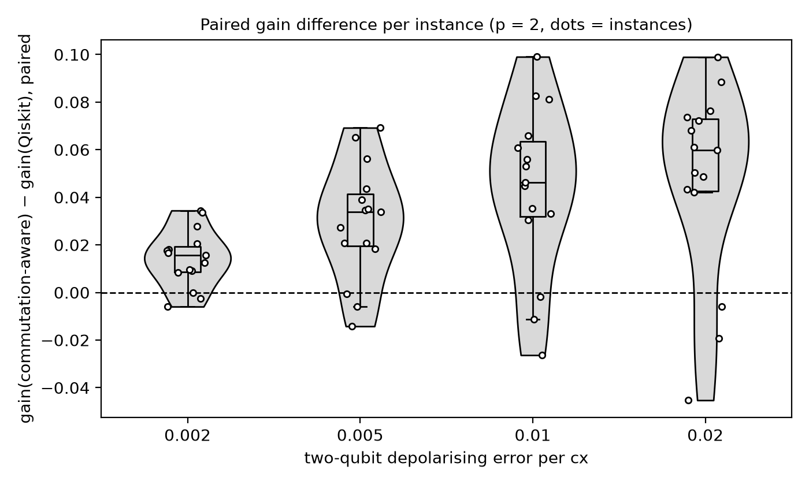
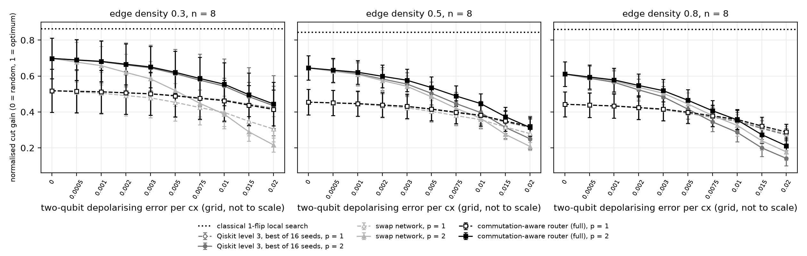
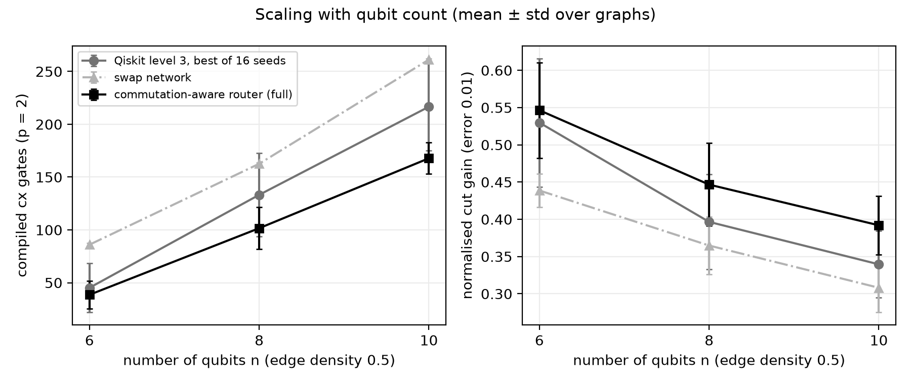

# How much of the noise budget of the Quantum Approximate Optimization Algorithm (QAOA) is a compiler decision?

[](LICENSE)
[](pyproject.toml)
[](https://github.com/pradeepdegalaroyal/commuting-qaoa-line-compiler-noise-budget/actions/workflows/ci.yml)

**Research question.** The cost layer of QAOA is a sum of commuting two-qubit terms, so its gate count on a line-connected device is a compiler outcome, not a property of the algorithm. Does exploiting that freedom move the noise level at which QAOA stops being useful?

**One-line answer (simulation, n = 8 qubits, 15 MaxCut graphs).** On graphs with edge density 0.5 and 0.8, a commutation-aware router uses 22.1 % and 27.3 % fewer controlled-NOT (CNOT, "cx") gates than Qiskit's level-3 compiler given the same search budget, raises the noisy solution quality at two-qubit error 0.01 by +0.050 and +0.069, and pushes the error rate where depth p = 2 stops beating p = 1 up by about 40 % and 60 %. On sparse graphs (density 0.3) it gives no reliable gain, and every noisy QAOA result stays far below a classical one-flip local search.

**Abstract.** I compile fixed, noiselessly optimised depth-1 and depth-2 QAOA circuits for MaxCut onto a line of qubits with eight compilers: Qiskit levels 1 and 3, a best-of-16 Qiskit baseline, the standard swap network, and a four-step ablation ladder of a commutation-aware router (free term order, fusion of a SWAP with an interaction term, and randomised restarts). Every circuit is evaluated exactly with a density-matrix simulator under depolarising gate noise swept from 0 to 0.02 per cx. The study reports gate counts, noisy solution quality, the break-even error of p = 2 versus p = 1, paired statistics over 15 graphs, and a scaling check to 10 qubits. It makes no claim of quantum advantage.

## What is new here

- A **component-by-component ablation** of the QAOA cost-layer router (waterfall in Figure 1), measured in noisy solution quality and not only in gate count.
- The effect of compilation is expressed as a **shift of the noise budget**: the error rate where p = 2 stops beating p = 1 and the error rate where solution quality halves, with right-censoring handled explicitly.
- A **fair compile-time budget**: the Qiskit baseline also gets 16 seeds, and the standard swap network is included, which exposes the density at which each baseline wins.
- A **classical reference solver** next to every quantum curve, and a negative result for sparse graphs.

## Motivation and research gap

Noise limits the size of circuits that run reliably on Noisy Intermediate-Scale Quantum (NISQ) devices (Preskill, 2018, digital object identifier (DOI) 10.22331/q-2018-08-06-79), and variational quantum algorithms still face trainability, accuracy and efficiency problems (Cerezo et al., 2021, DOI 10.1038/s42254-021-00348-9). Fidelity decays with the number of two-qubit gates (Boixo et al., 2018, DOI 10.1038/s41567-018-0124-x). For QAOA on MaxCut, Zhou et al. (2020, DOI 10.1103/PhysRevX.10.021067) supply the standard parameter-initialisation recipe, and recent work reports that the benefit of QAOA variants shrinks under noise partly because they add two-qubit operations (Lei et al., 2027, DOI 10.1016/j.trc.2026.106047), while QAOA is more noise-robust than deep Grover oracles (Lavanya et al., 2027, DOI 10.1007/978-3-032-30960-0_42). None of the supplied papers measures how much of that loss is decided by the compiler. The full related-work table, hypotheses and thresholds (fixed before the full run) are in [`docs/RESEARCH_GAP.md`](docs/RESEARCH_GAP.md).

## Evidence

All numbers below are copied from `results/` (comma-separated tables and `key_results.json`). Quality is the **normalised gain**: 0 = uniform random guess, 1 = optimal cut. Noise is a depolarising channel of strength 0.01 after each cx (and 0.001 after each single-qubit gate); mean ± standard deviation over 5 graphs per density, n = 8, p = 2.

### Main comparison (`results/summary_by_density.csv`)

| Compiler | density 0.3: cx / gain | density 0.5: cx / gain | density 0.8: cx / gain |
|---|---|---|---|
| Qiskit level 3, best of 16 seeds (baseline) | 70.8 ± 41.0 / 0.544 ± 0.152 | 133.2 ± 39.6 / 0.396 ± 0.064 | 194.4 ± 14.9 / 0.287 ± 0.052 |
| Swap network (baseline) | 161.0 ± 2.0 / 0.387 ± 0.067 | 162.6 ± 0.9 / 0.365 ± 0.038 | 163.4 ± 0.9 / 0.326 ± 0.059 |
| **Commutation-aware router (full)** | 64.8 ± 22.4 / 0.554 ± 0.119 | 101.6 ± 19.8 / 0.447 ± 0.056 | 141.0 ± 9.8 / 0.356 ± 0.054 |
| Noiseless QAOA (reference) | gain 0.698 | gain 0.645 | gain 0.611 |
| Classical one-flip local search (reference) | gain 0.863 | gain 0.843 | gain 0.860 |

Gate-count differences are large only for denser graphs; the router wins gain on every density but the margin on density 0.3 is smaller than the graph-to-graph spread. The classical reference beats noiseless depth-2 QAOA on every density.

### Hypotheses (`results/key_results.json`, paired over the 15 graphs, noise 0.01, p = 2)

| Hypothesis (threshold set beforehand) | Measured | Verdict |
|---|---|---|
| H1: at least 15 % fewer cx than Qiskit best-of-16 | mean per-graph reduction 16.3 % (ratio of mean counts 132.8 → 102.5, i.e. 22.8 %); fewer cx on 12 of 15 graphs; Wilcoxon p = 0.0024. By density: −0.5 %, 22.1 %, 27.3 % | supported overall, **not supported at density 0.3** |
| H2: gain at least 0.02 higher | +0.043 ± 0.035 (0.409 → 0.452), better on 12 of 15 graphs, Wilcoxon p = 0.0009. By density: +0.010, +0.050, +0.069 | supported overall, **not supported at density 0.3** |
| H3: break-even error of p = 2 vs p = 1 up by at least 10 % | 0.0125 → 0.0161 (+28.8 %, a lower bound because 6 of 15 router runs and 4 of 15 baseline runs never cross by 0.02); by density +9.8 % (4 of 5 censored in both, inconclusive), +40 %, +60 % | supported overall, inconclusive at density 0.3 |

Further measured facts: the router beats the swap network in gain on 15 of 15 graphs (mean difference +0.093, Wilcoxon p = 6.1e-5). At n = 8 the swap network beats Qiskit best-of-16 only at density 0.8 (0.326 vs 0.287), not at 0.3 (0.387 vs 0.544) or 0.5 (0.365 vs 0.396). Across graphs the cx saving and the gain improvement are almost perfectly rank-correlated (Spearman ρ = −0.95, p = 3.8e-8), which is expected here because gate noise is the only error source in the model.

### Figures



*Figure 1. Free term order removes the most cx gates (225 → 136 on average); fusion and restarts remove 21 and 12 more, and the full router (102 cx, gain 0.452) passes the Qiskit best-of-16 line (133 cx, gain 0.409).*



*Figure 2. Per graph, the router saves most cx on dense graphs; on density 0.3 it uses more cx than Qiskit on three of five graphs and has the higher gain on only two.*



*Figure 3. The paired gain difference grows with the error rate (median +0.016 at 0.002, +0.046 at 0.01, +0.060 at 0.02), and three of the 15 graphs have a negative difference at each error level shown.*



*Figure 4. On densities 0.5 and 0.8 the dashed p = 1 and solid p = 2 curves cross at lower error for the baselines than for the router; the dotted classical reference stays above all quantum curves.*



*Figure 5. From n = 6 to 10 the router's cx saving against Qiskit is 14.6 %, 23.7 % and 22.5 %, and its gain stays ahead (0.546, 0.447, 0.392 vs 0.530, 0.396, 0.339).*

Scaling numbers (`results/summary_scaling.csv`, density 0.5, p = 2, noise 0.01, 5 graphs):

| n | Qiskit best-of-16: cx / gain | Swap network: cx / gain | Router (full): cx / gain |
|---|---|---|---|
| 6 | 45.2 ± 23.1 / 0.530 ± 0.086 | 86.0 ± 1.4 / 0.439 ± 0.022 | 38.6 ± 13.0 / 0.546 ± 0.064 |
| 8 | 133.2 ± 39.6 / 0.396 ± 0.064 | 162.6 ± 0.9 / 0.365 ± 0.038 | 101.6 ± 19.8 / 0.447 ± 0.056 |
| 10 | 216.6 ± 41.5 / 0.339 ± 0.045 | 261.2 ± 1.1 / 0.308 ± 0.033 | 167.8 ± 14.9 / 0.392 ± 0.039 |

Ablation ladder (`key_results.json`, all 15 graphs): fixed-order routing 224.7 cx / gain 0.312; + free term order 135.7 / 0.408; + SWAP-interaction fusion 114.9 / 0.433; + 16 random restarts 102.5 / 0.452. A noiseless check confirms that every compiled circuit reproduces the ideal expectation (largest difference 3.3e-14).

## Method

```mermaid
%%{init: {'theme': 'base', 'themeVariables': {'primaryColor': '#ffffff', 'primaryTextColor': '#000000', 'primaryBorderColor': '#000000', 'lineColor': '#000000', 'secondaryColor': '#ffffff', 'tertiaryColor': '#ffffff', 'background': '#ffffff', 'noteBkgColor': '#ffffff', 'noteTextColor': '#000000', 'actorBkg': '#ffffff', 'actorBorder': '#000000', 'actorTextColor': '#000000', 'signalColor': '#000000', 'signalTextColor': '#000000', 'labelBoxBkgColor': '#ffffff', 'labelTextColor': '#000000', 'clusterBkg': '#ffffff', 'clusterBorder': '#000000'}}}%%
flowchart TD
  subgraph IN["Inputs: problem.py"]
    A["Erdős–Rényi MaxCut graphs<br/>n = 8, density 0.3 / 0.5 / 0.8<br/>5 graphs each"]
    B["Noiseless QAOA parameters<br/>p = 1 and p = 2<br/>INTERP initialisation, frozen"]
  end
  subgraph CO["Compilers on a line: compilers.py"]
    C["Qiskit level 3, best of 16 seeds<br/>SABRE layout and routing<br/>baseline"]
    D["swap_network<br/>odd-even transposition<br/>baseline"]
    E["Ablation ladder<br/>ordered_route, commute_order,<br/>commute_fuse"]
    F["commute_fuse_multistart<br/>16 random restarts<br/>proposed router"]
  end
  subgraph EV["Evaluation: evaluate.py and analysis.py"]
    G["Aer density matrix<br/>depolarising noise 0 to 0.02 per cx<br/>exact output distribution"]
    H["Normalised gain, cx count, depth,<br/>break-even error, paired tests"]
    I["Result tables in results<br/>Figures in figures"]
  end
  A --> B
  B --> C
  B --> D
  B --> E
  E --> F
  C --> G
  D --> G
  E --> G
  F --> G
  G --> H
  H --> I
  classDef bw fill:#ffffff,stroke:#000000,color:#000000,stroke-width:2px;
  class A,B,C,D,E,F,G,H,I bw;
```

*Legend: QAOA = Quantum Approximate Optimization Algorithm; INTERP = interpolation-based parameter initialisation; SABRE = SWAP-based BidiREctional heuristic search; cx = controlled-NOT gate; p = number of QAOA layers.*

QAOA parameters are optimised once without noise (Zhou et al., 2020 initialisation for p = 2) and passed unchanged to every compiler, so differences come from compilation alone. The router exploits three freedoms of the commuting cost layer: any currently adjacent term may run first; a SWAP on a pair that also carries a pending term is fused into 3 cx instead of 5; and the cheapest of 16 randomised runs is kept. Noise is a depolarising channel after every cx (strength λ) and after every single-qubit gate (λ/10), evaluated exactly with a density-matrix simulator. Details: [`docs/METHOD.md`](docs/METHOD.md).

## Discussion, including negative results

- **Where it helps:** dense graphs, where the default compiler inserts many SWAPs. The saving grows from n = 6 to n = 8 and then stays near 22–24 % at n = 10.
- **Where it does not:** at density 0.3 the cx saving is −0.5 % on average and the gain improvement (+0.010) is below the 0.02 threshold; the router uses more cx than Qiskit best-of-16 on three of five graphs and has the higher gain on only two, so H1 and H2 fail there.
- **Fair-budget caveat:** the router's best-of-16 includes random initial layouts, whereas the Qiskit baseline varies only the transpiler seed. Without restarts the router (`commute_fuse`, 114.9 cx, gain 0.433) is still ahead of Qiskit in gain overall (0.409), but the advantage then rests mostly on free term order and fusion.
- **No advantage claim:** the classical one-flip local search reaches gain 0.855 on average, higher than noiseless depth-2 QAOA (0.611–0.698) on every density, so compilation improves a quantum result that is still dominated classically at this scale.
- **Break-even estimates are lower bounds:** the grid stops at 0.02, so runs that never cross are censored at 0.02. For density 0.3 this makes the comparison inconclusive.
- **Shallow depth is not rewarded:** the swap network has the smallest depth (73.8 against 132.0 for Qiskit at density 0.5) but loses on gain because the noise model has no idle decoherence; with idle noise its ranking could change.

## Limitations

- Simulation only: n ≤ 10 qubits, exact density matrices, 5 graphs per density (15 for the main study). The scaling check covers one density.
- The noise model is depolarising gate noise only; there is no idle decoherence, crosstalk, read-out error or shot noise, and parameters are not re-optimised under noise.
- One topology (a line) and unit-weight Erdős–Rényi graphs. Conclusions do not transfer automatically to heavy-hex or grid devices.
- Several hypotheses and many comparisons are reported without multiple-testing correction; the p-values are descriptive.
- The router is a greedy heuristic and is not claimed to be optimal.

## Future work

- Replace the line by heavy-hex and two-dimensional grid couplings, and add idle decoherence and read-out error so that depth is rewarded.
- Re-optimise parameters on the compiled noisy circuit and compare with the frozen noiseless parameters used here.
- Test whether the same commuting-term freedom lowers routing cost in a fault-tolerant setting, where the number of arbitrary-angle rotations per layer is fixed by the edge count but routing and layout costs are not.
- Run the same compilers on hardware and compare measured fidelity with the depolarising prediction, using device-calibrated per-gate errors instead of a uniform rate.

Related work by the author: [`modular-chip-aware-qaoa-placement`](https://github.com/pradeepdegalaroyal/modular-chip-aware-qaoa-placement) (vertex placement for QAOA across two chips) and [`qaoa-best-of-k-sampling-noise`](https://github.com/pradeepdegalaroyal/qaoa-best-of-k-sampling-noise) (depolarising noise versus best-of-K sampling).

## Reproducibility

```bash
pip install -r requirements.txt && pip install -e .
python -m pytest -q                      # 14 tests, about 10 s
python experiments/run_all.py --quick    # smoke run, about 35 s (writes to a temporary folder)
python experiments/run_all.py            # full study: results/ and figures/
python experiments/run_all.py --reuse    # re-analyse and re-plot the saved raw rows
```

The full run took 448.5 s on a Windows 11 laptop (Python 3.11.9, 16 central processing unit (CPU) threads, six used by the simulator; no graphics processor was needed). Seeds: graph seeds 0–4 per density, optimiser seed equal to the graph seed, transpiler seed 7 (+ 0…15 for best-of-16), router seed equal to the graph seed. The continuous integration workflow in `.github/workflows/ci.yml` runs the tests and the quick run on `ubuntu-latest`.

## Project structure

```
src/qaoacomp/problem.py       graphs, cut values, QAOA state vector, parameter optimiser, classical baseline
src/qaoacomp/compilers.py     Qiskit baselines, swap network, commutation-aware router and ablation switches
src/qaoacomp/evaluate.py      exact noisy evaluation with the Aer density-matrix simulator
src/qaoacomp/experiments.py   main study and scaling drivers
src/qaoacomp/analysis.py      paired tests, break-even and half-gain errors (with censoring)
src/qaoacomp/plots.py         black-and-grey figures
experiments/run_all.py        one-command reproduction
tests/test_core.py            equivalence, connectivity, fusion and noise tests
docs/                         RESEARCH_GAP.md, METHOD.md
results/                      raw rows, summaries, key_results.json
figures/                      fig1 ... fig5 at 200 dpi
```

## Citation

```bibtex
@software{degala_commuting_qaoa_line_compiler_2026,
  author  = {Degala, Chenchupradeep},
  title   = {Commutation-aware compilation of the QAOA cost layer on a line: effect on the noise budget},
  year    = {2026},
  version = {0.1.0},
  url     = {https://github.com/pradeepdegalaroyal/commuting-qaoa-line-compiler-noise-budget},
  license = {MIT}
}
```

MIT license (`LICENSE`). Citation metadata is also available in `CITATION.cff`.
